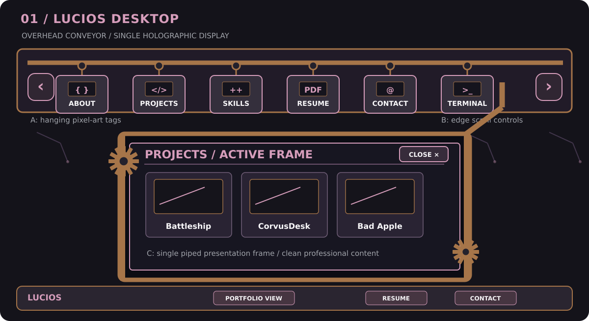
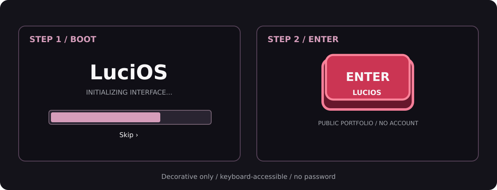
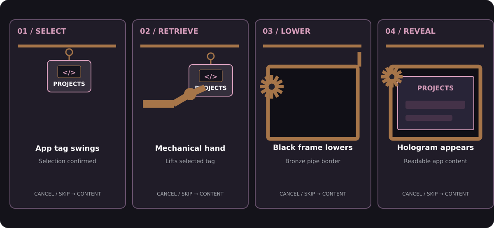
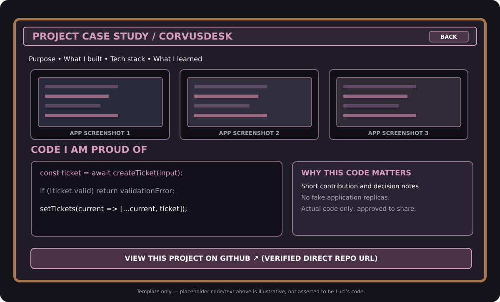
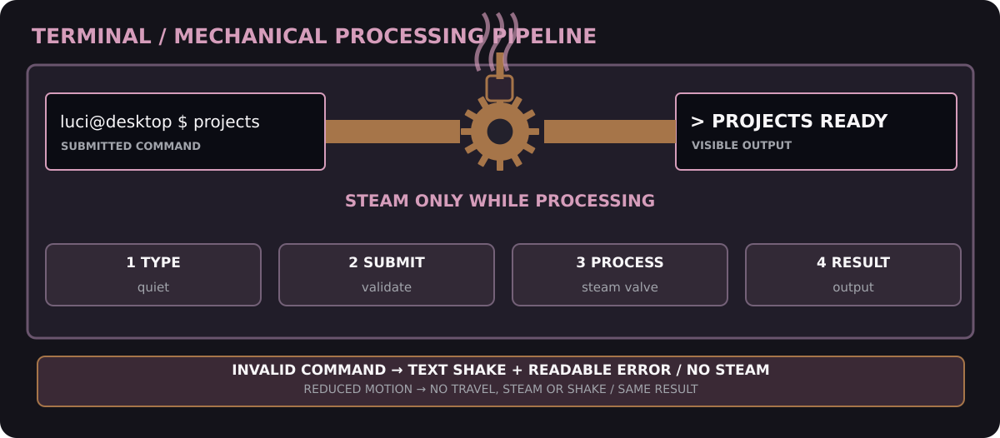

# LuciOS — UI/UX Design Specification

**Version 1.1 · October 22, 2026 · Prepared for Luci Crow**  
**Design thesis:** The portfolio is the interface. A steampunk machine delivering cyberpunk holograms.

> **Major approved redesign:** Hanging mechanical app conveyor **replaces the radial dial**. A single bronze-piped black display **replaces draggable floating windows**. Evidence-based project galleries **replace interactive dummy app previews**. Later mysteries are outside this specification.

## 1. Vision and design language

LuciOS is futuristic and elegant, original rather than resembling an existing commercial OS. It mixes the functional texture of old machinery (conveyor rail, hangers, gears, valves, bronze pipes and a small mechanical arm) with cyberpunk light (pink holographic content, faint circuits, soft emission). Crisp pixel-art application tags contrast with refined readable typography. The desktop background is animated, quiet and slightly spooky.

**Mood:** Mechanical curiosity, elegance, a little mystery — *not* cluttered, kitschy, or unreadable. The main content panel itself should resemble a modern professional case study even when surrounded by strange machine chrome.

| Token | Proposed color | Usage |
| --- | --- | --- |
| `--ink` | `#14131A` | Black canvas |
| `--charcoal` | `#23212C` | Controls / inset machinery |
| `--pink` | `#D69DBB` | Holographic edges and highlights |
| `--mist` | `#F8F7F9` | Primary readable text |
| `--steel` | `#A1A4AB` | Subtle neutral labels / rails |
| `--bronze` | `#A67549` | Pipes, hooks, machine parts (proposal) |
| `--enter-red` | `#CB3553` | Oversized entry button only |

## 2. Information architecture and user pathways

```text
ENTRY
  ├─ Enter LuciOS → Desktop Shell → Overhead Rail → Mechanical Loader → Display Frame
  │                                                            ├─ About
  │                                                            ├─ Projects → 3 case studies
  │                                                            ├─ Skills
  │                                                            ├─ Resume
  │                                                            ├─ Contact
  │                                                            └─ Terminal
  └─ Portfolio View → About / Projects / Skills / Resume / Contact (same content data)

Persistent shortcuts: Portfolio View / Resume / Contact.
```

A visitor should never have to discover secret controls just to get hired. There is no password and no secondary OS in this release.

## 3. Wireframe A — overview of the mechanical desktop



**Annotations:** (A) A dark rotating rail stretches across the top, with app tags hanging by hooks; (B) edge arrows and hover zones advance the carousel; (C) the single bronze-piped black **DisplayFrame** overlays the desktop when an app is active; (D) prominent Resume, Contact, and Portfolio View shortcuts remain outside the effect; (E) the wallpaper has low-amplitude eerie motion, off for reduced motion.

**Behavior:** A hanging tag is a real focusable button. The screen does not require perfect hover positioning; buttons and keyboard navigation perform the same function. Pixel icons are decorative alongside text labels, never the only app identifiers.

## 4. Wireframe B — boot and entry



- A decorative startup progress bar and logo appear briefly; a clear Skip action exists.
- The next screen contains the large three-dimensional red **Enter LuciOS** button on black.
- The action is labeled for assistive technology and activated with Enter/Space as well as click.
- The entry is an invitation, **not an account login**.

## 5. Wireframe C — opening an application



| Stage | State | Meaning | Implementation tier |
| --- | --- | --- | --- |
| 1 | Select / swing | Rail tag becomes selected, sways briefly | Core / easy CSS |
| 2 | Retrieve | Mechanical hand takes the tag from the hook | Progressive animation; simplified arm acceptable |
| 3 | Lower | Blank black screen lowers over desktop, framed by bronze pipes including upward exit at right | Core display and basic transform |
| 4 | Insert / reveal | Tag meets frame; gears move, brief load steam, holographic content materializes inside | Basic content **must** work; animation enhances |

**Important UX decision:** One application frame is active at a time. It can be dismissed or switched, but **v1.1 does not require freely draggable, resizable, overlapping windows**. Show a labeled Close/Back control integrated into the right-hand pipe/control assembly. The app's heading and body remain readable in a conventional layout.

**Interaction timing:** A visual flourish must not create lengthy fake delays. Pressing Escape, changing apps or toggling reduced motion cancels an animation and leaves a coherent open/closed state. Any effect that fails should resolve to a working app frame.

## 6. Wireframe D — real work in the Projects application



Projects initially features **Battleship, CorvusDesk and Bad Apple Repair**. Each gallery card enters a separate case-study view. The case study is not a fake interactive copy of the project.

**Exact page sequence for each project:**

1. Project name and plain-language description of the problem.
2. Luci's actual role, implementation contributions, technologies, decisions and results or lessons learned.
3. **Three** approved and **genuine** pictures/screenshots of the application or website while running, each with meaningful caption and alt text. Clicking a picture opens an accessible larger image.
4. A **“Code I’m proud of”** section: selected code Luci wrote, preferably rendered with real syntax-highlighted text, optionally accompanied by safe screenshots of that code. Each highlight explains why it matters.
5. A clearly labeled **“View this project on GitHub”** link at the **bottom** of that particular project's section, directed to the actual verified repository (not a generic profile, not a fabricated link).

**Media fallback:** If screenshot/code is missing or not safe to publish, mark it as awaiting approval during development. Do not claim an incomplete project page is ready for public release. All code sections must be readable and avoid leaking secrets or customer information.

## 7. Wireframe E — mechanical Terminal



**The exact animation rule:** Steam is released **only while a supported command is processing after Enter**. Not while typing. Not when validating and rejecting an unknown command. This is a strict design contract.

| State | Visible reaction | Output / accessible fallback |
| --- | --- | --- |
| Idle / Typing | Command enters input field; no steam, no valve event | Standard labeled text input |
| Validating | Check against local allowlist | Announce error if invalid |
| Invalid | Wrong word shakes gently once; valve remains still | Visible readable error + suggestion |
| Transfer | Accepted command travels left-to-middle through pipe | Command remains in accessible history |
| Processing | **Pressure-release valve vents steam**, gears may rotate | Busy state / brief nonblocking status |
| Reveal | Steam stops; result emerges from right pipe | Text output appears in ordinary accessible region |
| Reduced motion | No shake, travel, steam or wallpaper animation | Same result/error immediately |

Local command allowlist: `help`, `about`, `projects`, `skills`, `resume`, `contact`. Nothing is executed on an actual computer/server. Any navigational command can open the appropriate real portfolio section.

## 8. Supporting application surfaces

| App | Visual and content guidance |
| --- | --- |
| About | Quiet personnel/profile layout; 100–250 word biography; clear academic and professional areas |
| Skills | Structured language/tool/network/repair categories; genuine experience labels, no bogus percentages |
| Resume | Clear Preview and Download PDF actions; keyboard-operable PDF fallback link |
| Contact | Safe contact route, GitHub profile and LinkedIn if applicable/verified |
| Portfolio View | Direct readable linear sections matching the app data, independent of the rail/loader |
| Projects | Three cards leading to the evidence-based case-study template above |
| Terminal | Stylized pipe-and-valve shell with plain readable text and explicit command help |

## 9. Low-level user stories and acceptance criteria

| ID / link | Visitor story | Acceptance check |
| --- | --- | --- |
| US-01 · FR-01 | As a visitor, I want a short entry so I can get to the site quickly. | Skip/Enter works; no credentials; motion not mandatory. |
| US-02 · FR-02/03 | As an explorer, I want to move the overhead rail to find applications. | Hover edge, click arrow, Tab/arrow keyboard choices access all tags. |
| US-03 · FR-04 | As a visitor, I want an app to open in the presentation machine. | Selected tag opens the correct labeled content in one frame. |
| US-04 · FR-05 | As a curious visitor, I want the hand/pipe mechanism to suggest real machinery. | Swing/retrieval/frame/reveal staged animation; no blocking if skipped. |
| US-05 · FR-04/12 | As a hiring manager, I want to close the display and navigate directly. | Close restores focus; Portfolio View always reachable. |
| US-06 · FR-07 | As a technical reviewer, I want to see a real project running. | Each project has exactly three genuine screenshots and captions. |
| US-07 · FR-07/08 | As a reviewer, I want to read code Luci wrote and why it matters. | Readable highlights, explanation and magnification where necessary. |
| US-08 · FR-07 | As a hiring manager, I want the exact source repo after each case study. | Verified per-project GitHub link appears below all project content. |
| US-09 · FR-10 | As a recruiter, I want to download the resume quickly. | Direct PDF action works from quick shortcut and app/Portfolio View. |
| US-10 · FR-11 | As a recruiter, I want a safe way to contact Luci. | Verified contact link is visible without a mechanical interaction. |
| US-11 · FR-13 | As a terminal user, I want a valid command to move through machinery. | Transfer → processing steam → reveal; correct text result. |
| US-12 · FR-13 | As a terminal user, I want helpful feedback for a typo. | Shake + readable error; valve does **not** steam. |
| US-13 · NFR-02 | As a motion-sensitive user, I want to skip animation. | Reduced motion skips rail sway, hand, steam and background; content available. |
| US-14 · NFR-01 | As a keyboard visitor, I want every essential section reachable. | Focus labels, arrow/Enter/Escape and Portfolio View work. |
| US-15 · NFR-08 | As the owner, I want to update project evidence easily. | Editing typed project data updates both OS project view and Portfolio View. |
| US-16 · NFR-03 | As a narrow-screen visitor, I want the content to stay readable. | Standard linear Portfolio View without horizontal overflow at 320px+. |

## 10. Detailed flows and state transitions

**Primary entry:** Open URL → brief boot (or Skip) → red Enter → desktop (or direct Portfolio View).  
**App selection:** Hover/arrow to chosen tag → click/Enter → select → (optional swing/retrieval/lower/insert) → show holographic app → Back/Close → rail.  
**Project evidence:** Projects → card → description → three screenshots → code highlights → direct verified repository link below → Back.  
**Terminal success:** Type → Enter → allowlist validates → word into pipe → processing valve steam → output exits → ready.  
**Terminal failure:** Type unsupported word → Enter → shake + readable error; **no steam** → try again.  
**Accessibility fallback:** Any phase → reduce-motion / Skip → app content or Portfolio View immediately.

## 11. Desktop-first vs. mobile release expectations

Luci explicitly chose to design **desktop** first and defer a phone-like LuciOS. To preserve the assignment's multi-device requirement, the MVP should show a **simple, readable single-column portfolio** on narrow screens, with project evidence, resume and contact working. The elaborate rail/hand choreography can disappear or become a static navigation list; this is a minimum access adaptation, not a separate mobile OS design project.

## 12. Technical handoff and phased visual fidelity

- React components: `BootSequence`, `EnterScreen`, `DesktopShell`, `OverheadAppRail`, `RailTag`, `MechanicalLoader`, `DisplayFrame`, `PortfolioView`, six app panels, `ProjectCaseStudy`, `CodeHighlight`, `PipeValveSequence`.
- UI state: `entryPhase`, `railIndex`, `selectedApp`, `loaderPhase`, `displayOpen`, `reducedMotion`; use stable app IDs.
- Phase fidelity: first render a functioning rail/button and black frame; then hooks and bronze pipes; finally articulated hand, gear/pink hologram and atmospheric polish.
- Data source: real authenticated project evidence as content entries; verify screenshot provenance and repo access.
- Security: no backend shell execution, private assets, or fabricated demos.
- Testing: keyboard traversal, skipped animations, app switch during loader, image fallback, repo destination, read-friendly Portfolio View.

## 13. Unresolved visual decisions

Exact mechanical hand design and realism; conveyor loop/scroll speed; time and shape of gear/steam effects outside Terminal; wallpaper illustration; optional audio. Unless designed later, sound is **off**. The chosen signature interaction is the **overhead hanging app rail with mechanical retrieval**, replacing the old radial launcher.

**Out of scope:** mystery puzzles, the garden, evilLuciOS, page-peel and ending; they are not part of this UI/UX MVP spec.
